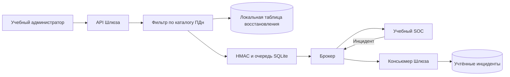

# Сетевой город · район №1 «Шлюз»

Репозиторий команды «Шлюз» объединяет исходный стенд и ЛР4–ЛР5. Основой послужил коммит [`45b74b5`](https://github.com/BlackscorpionSK/d1-gateway-lab1/commit/45b74b534e2e8c617143b1a6001d84ceee648c38).

## Как устроен стенд

- Основной Compose запускает API на `127.0.0.1:8080` и PostgreSQL во внутренней сети. У базы исходного стенда отдельный том.
- Слой `compose.tls.yaml` подключает Caddy и сертификаты города. Для TLS нужен локальный закрытый ключ, соответствующий сертификату. Устройство и проверка TLS описаны в [docs/tls.md](docs/tls.md).
- Слой `compose.labs.yaml` добавляет учебный брокер. Отдельные тома SQLite хранят очередь и обработанные события, данные брокера и таблицу восстановления псевдонимов.



При блокировке IP адрес и идентификатор администратора превращаются в псевдонимы. Только затем Шлюз подписывает событие. Сохранение правила и постановка события в очередь происходят в одной транзакции. При восстановлении брокера Шлюз продолжает отправку. При приёме `city.soc.incident.opened.v1` консьюмер проверяет подпись, время и контракт, записывает результат один раз и подтверждает сообщение.

Полная интеграция с Паспортным столом по OIDC и mTLS относится к ЛР3 и в исходнике остаётся незавершённой. Учебный токен открывает одну локальную админ-операцию. Проверка блокировки на `/api/v1/info` использует IP непосредственного TCP-клиента. Маршруты Caddy к другим районам обслуживаются самим Caddy, поэтому на них эта проверка не распространяется. Обмен проверяется с учебным SOC на этом же компьютере.

## Запуск

Нужны Docker Compose v2 и Python 3.12 или новее для проверок. Скопируйте `.env.example` в `.env`. Задайте случайный `DB_PASSWORD` и четыре отдельные случайные строки для `BUS_SECRET`, `BUS_CONSUME_SECRET`, `PRIVACY_SALT` и `GATEWAY_ADMIN_TOKEN`. Для каждого значения можно заново выполнить `python -c "import secrets; print(secrets.token_hex(32))"`.

```sh
docker compose -f compose.yaml -f compose.labs.yaml up --build -d
curl http://127.0.0.1:8080/health
```

В PowerShell используйте `curl.exe`. Для демонстрации отправьте `POST /api/v1/admin/block` с заголовком `Authorization: Bearer <GATEWAY_ADMIN_TOKEN>` и JSON `{"source":"192.0.2.42","reason_code":"scan"}`. Ответ `201` содержит `event_id` и статус `queued`. Статус подтверждает локальную запись. Доставку подтверждает сообщение `event.published` в журнале API.

Проверки создают временный стенд с синтетическими данными и свежими ключами. Для них достаточно Python и Git.

```sh
python scripts/check-bus.py
python scripts/check-privacy.py
```

См. [контракт событий](contracts/events.md), [HTTP API](contracts/openapi.yaml), [ЛР4](docs/bus.md), [ЛР5](docs/privacy.md) и [инструкцию восстановления](docs/recovery.md).

## Как распределить работу в команде

| Роль | Зона ответственности |
|---|---|
| **Илья · тимлид, архитектор и инженер инфраструктуры** | Согласует контракты и границы доверия с SOC и другими районами. Отвечает за Compose, сети, TLS, доступность брокера, тома, резервные копии и восстановление. Принимает изменения после испытания отказа. |
| **Кирилл · инженер безопасности** | Утверждает модель угроз, роли и каталог ПДн. Проверяет HMAC, защиту от повторов, разделение ключей, права на таблицу восстановления, сроки хранения и удаление по запросу. Независимо проверяет попытки подмены и утечки. |
| **Денис · разработчик-аналитик** | Формулирует API и сценарии обмена, реализует обработчик блокировки, продьюсер и консьюмер, применяет каталог к данным, пишет автоматические проверки и описывает наблюдаемые результаты. |

Это предлагаемое распределение ответственности для команды. Фактическая история изменений находится в Git.
