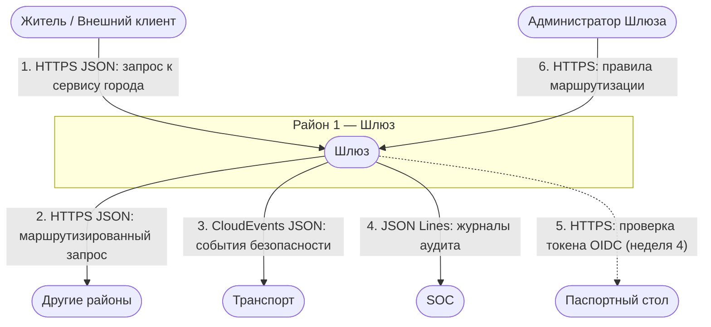
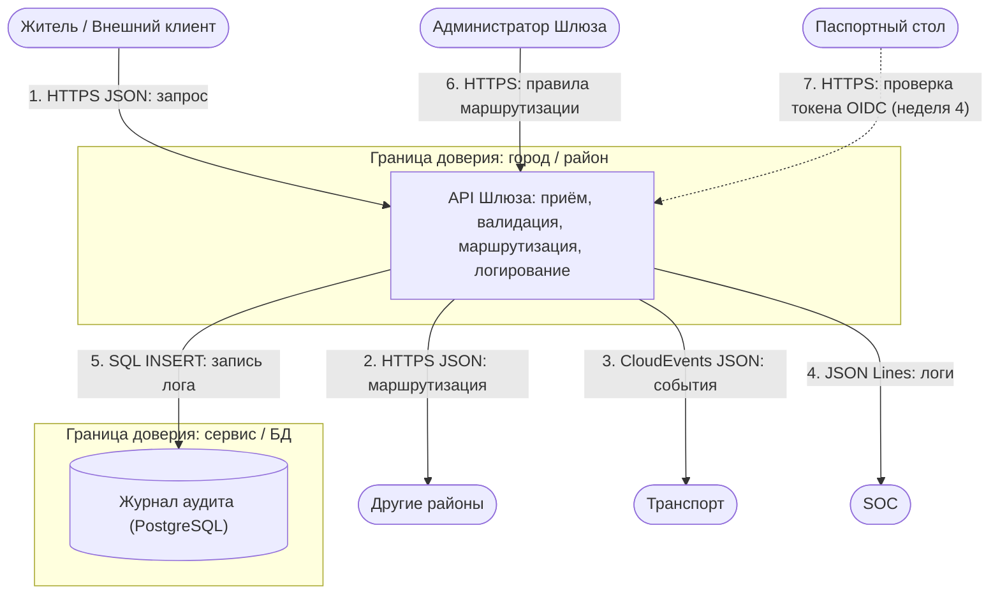

# Архитектура района 1 — Шлюз

Ниже приведён проект архитектуры v0. Фактически реализованные операции перечислены в [контракте API](../contracts/openapi.yaml). Устройство учебной шины и путь событий ЛР4–ЛР5 описаны в [README](../README.md).

**Команда:** <1> · **Тимлид:** <Переладов И.В.> · **Версия:** v0 · **Дата:** <19.10.26>

## 1. Назначение
Район «Шлюз» является единой точкой входа во все сервисы «Цифрового города» из внешней сети.
Он принимает запросы от жителей, проводит их базовую валидацию и маршрутизирует во внутренние районы.
Кроме того, Шлюз фиксирует все события безопасности и передаёт их в SOC для анализа.

## 2. Политика безопасности
Шлюз принимает запросы только через разрешённые интерфейсы и маршрутизирует их во внутренние районы исключительно при соответствии формату API города; подмена маршрутов и обход проверки прав категорически запрещены. Шлюз не хранит бизнес-данные пользователей,
а факт прохождения любого запроса, отказ в доступе и любое изменение конфигурации обязательно записываются в журнал аудита и передаются в SOC. 
Изменять правила маршрутизации и управлять доступами может только Администратор Шлюза, в то время как разработчики и команда эксплуатации отвечают за безопасную обработку запросов и мониторинг доступности сервиса.

## 3. Компоненты
| Компонент (сервис Compose) | Что делает | Технология | Порт внутри района | Виден другим районам? |
|---|---|---|---|---|
| api | Принимает запросы API, ведёт журнал и обменивается событиями | Python | 8080 | через Caddy при подключённом TLS |
| db | Хранит журнал аудита и событий безопасности | PostgreSQL | 5432 | нет (только для api) |

## 4. Схема потоков данных (DFD)

### Уровень 0 — Район как чёрный ящик

Уровень 1 - Внутренняя структура района

## 5. Границы доверия

| № | Граница | Что по разные стороны | Как контролируется сейчас (v0) | Как будет (неделя) |
|---|---|---|---|---|
| Г1 | Периметр Шлюза (город / район) | Внешняя сеть (Интернет) и API Шлюза | Входящий трафик только через порт 8080, базовая валидация формата запроса | WAF, TLS (3), SSO через Паспортный стол (4) |
| Г2 | Хранилище данных (сервис / БД) | API Шлюза и Журнал аудита (PostgreSQL) | Доступ к БД только из контейнера API по внутренней сети Docker, пароль в `.env` | Шифрование at rest, ротация паролей (7) |
| Г3 | Взаимодействие с районами (район / район) | API Шлюза и другие районы / Паспортный стол | Внутренняя сеть города, пока без строгой аутентификации | mTLS между сервисами (4), SSO-токены (4) |
| Г4 | Администратор / пользователь (внутри района) | Администратор Шлюза и обычные жители | Пока разделения нет (v0) | Разделение ролей, RBAC, журнал действий администратора (4) |

## 6. Внешние зависимости
| От кого зависим | Что получаем | Что будет, если он недоступен или скомпрометирован |
|---|---|---|
| Паспортный стол | вход пользователей, сертификаты | |
| Транспорт | доставка событий | |
| SOC | приём журналов | |

## 7. Соответствие соглашениям города
- [ ] Имена по Р1 (`d1-gateway`, `*.gateway.city.lab`)
- [ ] Время UTC (Р3)
- [ ] Журналы JSON Lines с обязательными полями (Р4)
- [ ] События в конверте CloudEvents (Р5), описаны в `contracts/events.md`
- [ ] API описан в `contracts/openapi.yaml`, есть `/health` (Р6)
- [ ] Секретов в Git нет (Р7)
