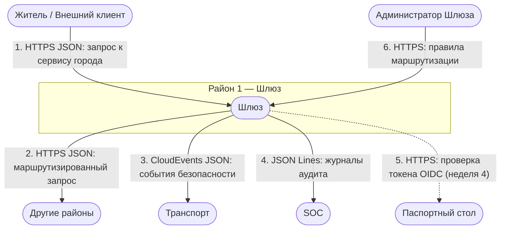
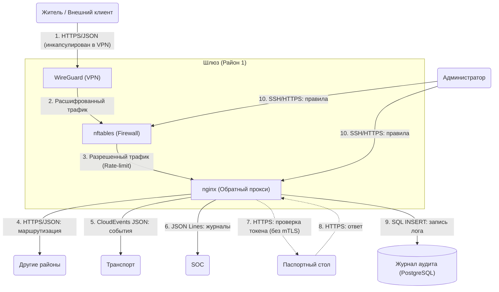

# Модель угроз района

> **Как пользоваться.** Версия v0 — к концу недели 2, v1 — к неделе 6. Понятия: Модель угроз, STRIDE, Модель нарушителя, Политика безопасности. Систему рассматриваем на уровне 6 — вместе с людьми (см. выжимку глав 1–2). Порядок работы — в «ЛР1. Архитектура района и модель угроз v0»; образец — «Городская библиотека»..

**Район:** 1 — Шлюз · **Команда:** <номер> · **Версия:** v0 / v1 · **Дата:** <дата> · **Авторы:** <ФИО>

## 1. Политика безопасности района
Шлюз принимает запросы только через разрешённые интерфейсы и маршрутизирует их во внутренние районы исключительно при соответствии формату API города; подмена маршрутов и обход проверки прав категорически запрещены. 
Шлюз не хранит бизнес-данные пользователей, а факт прохождения любого запроса, отказ в доступе и любое изменение конфигурации обязательно записываются в журнал аудита и передаются в SOC. 
Изменять правила маршрутизации и управлять доступами может только Администратор Шлюза, в то время как разработчики и команда эксплуатации отвечают за безопасную обработку запросов и мониторинг доступности сервиса.


## 2. Активы — что защищаем
| Актив                            | Где хранится / проходит                       | Что важнее: конфиденциальность, целостность, доступность | Почему ценен |
|---|---|---|---|
| Доступность входа в API города|Процесс Шлюза                                  |Доступность                                               |При отказе Шлюза пользователи могут потерять доступ сразу к нескольким районам| 
| Запросы и ответы              |Трафик через Шлюз                              |Конфиденциальность, целостность                           |Могут содержать персональные данные и результаты операций.|
| Ответы районных API           |Потоки между Шлюзом и сервисами                |Целостность, доступность                                  |Подмена ответа или неверная маршрутизация приводит к ошибкам для пользователя.|
| Сервисные секреты             |.env, секреты контейнера или хоста — проверить |Конфиденциальность                                        |Могут дать доступ к внутренним сервисам.|
| Учётная запись администратора |SSH/хост/средства управления контейнерами      |Целостность, конфиденциальность                           |Позволяет менять настройки и получать доступ к секретам.|

## 2. Что есть у атакующего (активы атакующего)
С чего противник может начать: что ему доступно легально или по сценарию игры.
| Возможность атакующего | Откуда она у него | Куда может привести |
|---|---|---|
| Доступ администратора или подрядчика | Инсайдер либо похищенная учётная запись | Изменение маршрутов, чтение секретов, сокрытие действий. |
| Клиентский компьютер и доступ к сети | Любой пользователь города | Некорректные, повторные или массовые запросы.|
| Сведения о внутреннем адресе сервиса | Ошибки, конфигурация или информация от другого пользователя | Попытка обойти ожидаемый маршрут и обратиться к внутреннему API |

## 3. Участники и роли
| Роль / принципал | Что может делать | Как аутентифицируется |
|---|---|---|
| Житель / внешний клиент|посылать HTTPS-запросы к районам| токен SSO Паспортного стола (неделя 4; пока — никак)|
| Районный сервис |Обрабатывать запросы, переданные Шлюзом, возвращать ответы|mTLS от Шлюза (неделя 3–4; пока — никак)|
| Паспортный стол |отдавать JWKS, проверять отзыв токена|mTLS; пока — HTTPS |
| Администратор Шлюза |править конфиги, перезапускать контейнеры| SSH на хост|
| SOC |Получать и анализировать журналы | mTLS (неделя 4)|


## 4. Схема потоков данных (DFD)
Опишите или вставьте схему: внешние участники, процессы (сервисы), хранилища данных, потоки между ними.


Уровень 1 - Внутренняя структура района


### Потоки данных

| №  | Откуда → куда | Что передаётся, протокол | Граница |
|----|---------------|--------------------------|---------|
| П1 | Житель / Внешний клиент → **WireGuard (Шлюз)** | HTTPS JSON: запрос к сервису города (метод, путь, заголовки, тело) | Г1: город / район |
| П2 | **nginx (Шлюз)** → Другие районы | HTTPS JSON: маршрутизированный запрос (проксированный запрос с добавленными заголовками аутентификации) | Г1: город / район |
| П3 | **nginx (Шлюз)** → Транспорт | CloudEvents JSON: события безопасности (попытки несанкционированного доступа, превышение rate limit) | Г1: город / район |
| П4 | **nginx (Шлюз)** → SOC | JSON Lines: журналы аудита (метаданные запросов: метод, путь, код ответа, IP-источник, ID пользователя, время) | Г1: город / район |
| П5 | **nginx (Шлюз)** → Паспортный стол | HTTPS: проверка токена OIDC (валидация JWT, запрос JWKS-ключей); пока — **без mTLS** (неделя 4) | Г1: город / район |
| П6 | Администратор Шлюза → **Хост Шлюза (nftables/nginx)** | SSH, правка конфигов, управление `.env`, перезапуск контейнеров | Г4: администратор / пользователь |
| П7 | **nginx (Шлюз)** → Журнал аудита (PostgreSQL) | SQL INSERT: запись лога (метаданные запроса, результат обработки, ошибки валидации) | Г2: сервис / БД |
| П8 | Паспортный стол → **nginx (Шлюз)** | HTTPS: ответ проверки токена OIDC (валидность токена, данные пользователя, список ролей); пока — **без mTLS** (неделя 4) | Г1: город / район |

## 5. Границы доверия
| № | Граница | Что по разные стороны | Как контролируется сейчас (v0) | Как будет (неделя) |
|---|---|---|---|---|
| Г1 | Периметр Шлюза (город / район) | Внешняя сеть (Интернет) и API Шлюза | Входящий трафик только через порт 8080, базовая валидация формата запроса | WAF, TLS (3), SSO через Паспортный стол (4) |
| Г2 | Хранилище данных (сервис / БД) | API Шлюза и Журнал аудита (PostgreSQL) | Доступ к БД только из контейнера API по внутренней сети Docker, пароль в `.env` | Шифрование at rest, ротация паролей (7) |
| Г3 | Взаимодействие с районами (район / район) | API Шлюза и другие районы / Паспортный стол | Внутренняя сеть города, пока без строгой аутентификации | mTLS между сервисами (4), SSO-токены (4) |
| Г4 | Администратор / пользователь (внутри района) | Администратор Шлюза и обычные жители | Пока разделения нет (v0) | Разделение ролей, RBAC, журнал действий администратора (4) |

## 6. Модель нарушителя
| Противник | Возможности | Мотив | Вероятность для нас |
|---|---|---|---|
|Внешний бот/сканер|интернет, скрипты, много IP|enumeration, DDoS, поиск уязвимостейвысокая|высокая|
|Житель-злоумышленник|своя учётка, браузер, curl, white-box|получить чужие данные, обойти лимиты|высокая|
|Ботнет|тысячи IP, большая пропускная способность|DDoS, отказ города|средняя|
|Администратор Шлюза (инсайдер)|SSH, .env, конфиги, доступ к buffer|любопытство, саботаж, продажа маршрутов|низкая|
|Атакующий из другого района|доступ к шине Транспорт, mTLS-сертификат своего района|подделать запрос, идущий «от Шлюза»|средняя|

## Элементы DFD
| № | Тип элемента | Название элемента | Описание в контексте сервиса |
|---|---|---|---|
| 1 | Внешний участник | Житель / Внешний клиент | Легитимный пользователь, инициирующий запросы к сервисам через Шлюз (Поток П1). |
| 2 | Внешний участник | Администратор | Управляющий персонал, имеющий SSH/HTTPS-доступ к конфигурации и хосту Шлюза (Поток П6). |
| 3 | Внешний участник | Паспортный стол (IdP) | Внешний сервис единого входа, выдающий токены и проверяющий их валидность (Потоки П5, П8). |
| 4 | Внешний участник | Городской SOC | Центр мониторинга, принимающий логи аудита и события безопасности для анализа (Потоки П3, П4). |
| 5 | Процесс | API Шлюза | Ядро района: принимает трафик, проверяет JWT-токены, маршрутизирует запросы, пишет логи и генерирует события. |
| 6 | Хранилище | Журнал аудита (PostgreSQL) | База данных для хранения метаданных запросов и ошибок валидации (Поток П7). |
| 7 | Поток данных | Поток П1: Житель → API Шлюза | Входящий HTTP(S) JSON-запрос на границе доверия «город / район». |
| 8 | Поток данных | Поток П5/П8: API Шлюза ↔ Паспортный стол | Проверка токена OIDC (валидация JWT, запрос JWKS-ключей), текущая передача **без mTLS**. |
| 9 | Поток данных | Поток П1: Клиент → WireGuard → nginx | Входящий HTTP(S) JSON-запрос, инкапсулированный в VPN-туннель, проходящий через фильтр nftables. |
| 10 | Поток данных | Поток П5/П8: nginx ↔ Паспортный стол | Проверка токена OIDC (валидация JWT, запрос JWKS-ключей). Передача пока без mTLS. |

## 7. Угрозы по STRIDE
Для каждого элемента DFD пройдите шесть классов угроз. Если класс неприменим — так и напишите.

| Элемент | S — подмена | T — изменение | R — отказ от авторства | I — утечка | D — отказ в обслуживании | E — повышение привилегий |
|---|---|---|---|---|---|---|
| **1. Житель / Внешний клиент** | Злоумышленник использует украденный JWT-токен для выдачи себя за легитимного жителя. | Клиент подменяет заголовки `Host` или `X-Forwarded-For`, чтобы обойти маршрутизацию или выдать себя за другой район. | Клиент отрицает отправку вредоносного запроса, а метаданных в логах недостаточно для его идентификации. | Перехват трафика (MITM) между клиентом и API Шлюза для кражи токена или передаваемых данных. | Ботнет инициирует массовый поток HTTP-запросов (флуд) на П1, вызывая исчерпание ресурсов API Шлюза. | **Не применимо.** Клиент не имеет прав в системе, повышение привилегий происходит только через эксплуатацию уязвимостей на стороне сервера. |
| **2. Администратор** | Злоумышленник получает доступ к SSH-ключу администратора и выдает себя за него для управления хостом Шлюза (П6). | Администратор (или злоумышленник с его правами) вручную изменяет `.env` или правила маршрутизации, перенаправляя трафик в обход защит. | Администратор отрицает, что именно он перезапустил контейнер или изменил конфигурацию, приведшую к сбою. | Утечка приватных SSH-ключей или паролей к БД из локального окружения администратора (ноутбука) в открытом виде. | **Не применимо.** Действия администратора носят точечный управляющий характер и не создают трафик, способный исчерпать ресурсы сервиса. | Администратор злоупотребляет правами на перезапуск контейнеров для получения root-доступа к хост-системе через уязвимости Docker. |
| **3. Паспортный стол (IdP)** | Атакующий подделывает ответ от Паспортного стола (П8) или публикует поддельные JWKS-ключи, чтобы выдать себя за сервер OIDC. | Компрометация Паспортного стола позволяет злоумышленнику выпустить токен с завышенными правами (например, администратора района). | Паспортный стол отрицает, что выдал токен с расширенными правами, из-за отсутствия журнала выдачи токенов. | Перехват ответа от Паспортного стола (П8) раскрывает персональные данные пользователя и список его ролей. | Отказ в обслуживании Паспортного стола (или сетевые проблемы) блокирует процесс валидации токена (П5) и делает сервисы города недоступными. | **Не применимо.** IdP — это внешний сервис доверия, Шлюз не может получить в нем привилегии. |
| **4. Городской SOC** | Злоумышленник подделывает источник журналов (выдает себя за API Шлюза) и отправляет ложные JSON Lines, чтобы скрыть реальную атаку. | MITM-атака на поток П4 позволяет злоумышленнику модифицировать или удалить записи о несанкционированных запросах до их попадания в SOC. | API Шлюза отрицает генерацию алерта (П3), утверждая, что сбой был внутренним, а логов для доказательства обратного нет. | Журналы (П4) содержат избыточные чувствительные данные (тела запросов, токены), которые утекают при перехвате или инсайде в SOC. | Массивный DDoS-флуд или «логический шторм» забивает канал П4, вызывая переполнение хранилища логов и слепоту SOC. | **Не применимо.** SOC — это пассивный приемник телеметрии, он не выполняет прикладных действий в сервисе и не может повысить права. |
| **5. API Шлюза** | Злоумышленник эксплуатирует уязвимость в парсере JWT или библиотеке маршрутизации, чтобы внедрить поддельного пользователя. | SQL-инъекция через параметры запроса П1 позволяет изменить логику работы API или внедрить команды в конфигурацию. | При отказе в доступе (403) API не фиксирует достаточных данных, чтобы доказать, кто именно пытался получить доступ к закрытому ресурсу. | Утечка чувствительных данных при генерации ответа из-за ошибки конфигурации. | «Медленные» атаки (Slowloris) или исчерпание пула соединений к БД (П7) заставляют API перестать отвечать на легитимные запросы. | Уязвимость удаленного выполнения кода (RCE) в зависимостях API позволяет злоумышленнику получить контроль над процессом и доступ к БД. |
| **6. Журнал аудита (PostgreSQL)** | Злоумышленник, получивший доступ к внутренней сети, подключается к PostgreSQL под учетной записью API Шлюза. | Злоумышленник с правами записи в БД изменяет записи аудита (П7), чтобы скрыть следы вредоносного запроса. | Администратор БД удаляет логи, чтобы скрыть факт компрометации, и утверждает, что логов не было. | Прямой доступ к БД (например, через уязвимость) позволяет злоумышленнику выгрузить всю историю аудита с IP-адресами и ID пользователей. | Неограниченный рост таблиц логов из-за отсутствия ротации приводит к переполнению диска и падению PostgreSQL. | **Не применимо.** БД является пассивным хранилищем, повышение привилегий возможно только через RCE в самом PostgreSQL. |
| **7. Поток П1 (Житель → API)** | Злоумышленник использует валидный токен другого пользователя (украденный) для совершения действий от его имени на границе доверия. | Модификация тела HTTP-запроса (JSON) в процессе передачи, если соединение не защищено должным образом, для изменения параметров операции. | Отправка анонимного запроса (без токена) или с искаженным токеном, который не логируется должным образом, чтобы скрыть факт перебора. | Использование открытого Wi-Fi для отправки запросов без HTTPS позволяет перехватить содержимое JSON и украсть конфиденциальные данные. | Отправка огромного количества запросов с одного IP-адреса (или подсети) для блокировки доступа остальным жителям. | **Не применимо.** Поток передает только входящие данные, повышение привилегий невозможно на транспортном уровне. |
| **8. Поток П5/П8 (Шлюз ↔ IdP)** | Злоумышленник имитирует Паспортный стол (DNS-спуфинг или подмена IP), чтобы выдать поддельный ответ о валидности токена. | Подмена ответа (П8) при валидации токена, чтобы добавить пользователю роль администратора. | Отсутствие mTLS позволяет подделать запрос (П5) от имени Шлюза и получить данные о пользователе. | Перехват трафика (П5/П8) из-за отсутствия mTLS раскрывает данные пользователя, JWKS-ключи и внутренние идентификаторы ролей. | Паспортный стол отвечает медленно или недоступен, из-за чего API Шлюза «зависает» в ожидании ответа (П8). | **Не применимо.** Это транспортный поток, он не исполняет код и не управляет правами доступа самостоятельно. |

### Реестр угроз
Каждая угроза — отдельная строка. Риск = вероятность (1–5) × ущерб (1–5).
| ID | Элемент DFD | STRIDE | Угроза: кто, что делает, к чему приводит | Вероятность | Ущерб | Риск | Обоснование (Почему) | Мера  |
|---|---|---|---|---|---|---|---|---|
| T01 | Поток П1 (Клиент → API) | S | Злоумышленник находит украденный JWT-токен жителя в открытых логах nginx и отправляет запросы в API Шлюза, выдав себя за него. | 4 | 3 | 12 | **Почему:** Nginx по умолчанию пишет заголовки в лог, и если их не маскировать, токен утечет (В=4), но злоумышленнику придется найти доступ к этим логам, а ущерб ограничен правами одного жителя (У=3). | M01 |
| T02 | Администратор | T | Пользователь с правами администратора вручную меняет файл `.env` на хосте Шлюза (через SSH), чтобы отключить проверку mTLS в тестовой среде и забывает вернуть обратно. | 3 | 4 | 12 | **Почему:** Человеческий фактор при ручном управлении высок (В=3), а отключение проверки безопасности на Шлюзе открывает прямой доступ ко всем районам (У=4). | M02 |
| T03 | API Шлюза | R | Житель отправляет вредоносный запрос, который крашит API Шлюза, но в логах SOC не сохраняется ID устройства, и доказать его причастность невозможно. | 4 | 3 | 12 | **Почему:** Если логирование настроено небрежно, неатрибутированные инциденты будут возникать часто (В=4), но ущерб ограничен сложностью расследования конкретного сбоя, а не всей сети (У=3). | M03 |
| T04 | API Шлюза | I | Разработчик добавляет в конфигурацию nginx вывод полного текста ошибки с путями к файлам, и при сбое злоумышленник узнает структуру директорий. | 3 | 4 | 12 | **Почему:** Ошибки конфигурации nginx случаются не каждый день (В=3), но раскрытие структуры директорий помогает злоумышленнику подготовить целенаправленную атаку на файловую систему (У=4). | M04 |
| T05 | API Шлюза | D | Ботнет запускает HTTP-флуд на эндпоинт `/health` (который не требует JWT), API Шлюза исчерпывает лимиты CPU и перестает обрабатывать легитимные запросы. | 4 | 3 | 12 | **Почему:** Флуд на публичные эндпоинты — стандартная практика атакующих (В=4), но отказ Шлюза вызывает лишь временную недоступность, данные не теряются (У=3). | M05 |
| T06 | Поток П5/П8 (Шлюз ↔ IdP) | I | Перехват трафика между Шлюзом и Паспортным столом (поток П5/П8) из-за отсутствия mTLS позволяет злоумышленнику прочитать валидные токены и украсть персональные данные жителей. | 5 | 4 | 20 | **Почему:** По схеме поток П5/П8 идет без mTLS (В=5 - атаковать легко изнутри сети), а перехват токенов дает доступ к ПДн всех жителей города (У=4). | M06 |
| T07 | Поток П5/П8 (Шлюз ↔ IdP) | T | Злоумышленник меняет ответ от Паспортного стола (П8) в процессе передачи, подменяя роль пользователя в JWT-токене с «жителя» на «администратора района». | 4 | 4 | 16 | **Почему:** Отсутствие mTLS позволяет легко внедриться в трафик (В=4), а подмена роли в токене дает полный контроль над районом (У=4). | M07 |
| T08 | Городской SOC | I | Журналирование всех входящих запросов (П4) в SOC включает полные заголовки `Authorization: Bearer <token>`, и сотрудник SOC может украсть токен и войти в город. | 4 | 4 | 16 | **Почему:** Сотрудники SOC имеют легитимный доступ к логам (В=4), а наличие токенов в открытом виде позволяет им скомпрометировать любого пользователя (У=4). | M08 |
| T09 | Паспортный стол (IdP) | D | При массовом отказе основного Паспортного стола, API Шлюза не имеет настроенного таймаута и «зависает» в ожидании ответа (П5), блокируя обслуживание всех районов. | 3 | 4 | 12 | **Почему:** Отказы IdP случаются периодически (В=3), но из-за отсутствия таймаутов они каскадно роняют весь Шлюз и отрезают город от связи (У=4). | M09 |
| T10 | Хранилище (Журнал аудита) | I | Администратор оставляет резервную копию файла `.env` (с приватными ключами WG и паролями БД) на общедоступном сетевом ресурсе или в Git-репозитории. | 4 | 4 | 16 | **Почему:** Случайные коммиты с секретами — частая ошибка (В=4), а утечка ключей WG и БД дает доступ ко всей инфраструктуре города (У=4). | M10 |
| T11 | Поток П1 (Клиент → API) | D | Атакующий инициирует медленную отправку заголовков (Slowloris) на порт 443, исчерпывая пул воркеров nginx, и новые жители не могут подключиться к Шлюзу. | 4 | 3 | 12 | **Почему:** Инструменты для Slowloris общедоступны (В=4), но атака вызывает лишь временный сбой в обслуживании, не затрагивая данные (У=3). | M11 |
| T12 | Хранилище (Журнал аудита) | I | Из-за отсутствия шифрования (TDE) украденный бэкап базы данных Журнала аудита (PostgreSQL) позволяет злоумышленнику прочитать историю всех действий и IP-адресов жителей. | 3 | 4 | 12 | **Почему:** Кража бэкапа требует времени (В=3), но утечка истории действий всех жителей — это серьезный репутационный ущерб (У=4). | M12 |
| T13 | Шлюз (Контейнер nginx) | E | Атакующий эксплуатирует уязвимость в nginx или ошибку конфигурации Docker (`--privileged`), чтобы выйти из контейнера, получить root-доступ к хосту Шлюза и изменить правила маршрутизации nftables. | 3 | 5 | 15 | **Почему:** Требуется найти уязвимость или ошибку конфига (В=3), но получение root на Шлюзе означает полный контроль над периметром города (У=5). | M13 |


## 8. Дерево атаки (для самой ценной цели)
```
Цель: выполнить операцию в Банке от имени чужого жителя
├── ИЛИ: подделать JWT (T01)
│   ├── И: узнать слабый секрет auth (.env, Git, журнал) (T10)
│   ├── И: использовать alg:none или подменить JWKS (T07)
├── ИЛИ: украсть чужой токен
│   ├── И: получить токен из журнала SOC (T08)
│   ├── И: перехватить TLS (MITM на Г1) (T06)
│       ├── И: скомпрометировать TLS-ключ gateway
│       ├── И: клиент не проверяет сертификат (pinning)
├── ИЛИ: replay чужого запроса (T14)
│   ├── И: перехватить запрос (MITM или вредоносное расширение)
│   ├── И: gateway не проверяет nonce/Idempotency-Key
├── ИЛИ: заставить gateway проксировать запрос от своего имени (T07)
│   ├── И: атакующий — другой район с валидным mTLS
│   ├── И: gateway не подписывает исходящие запросы к бэкендам
```

## 9. Меры защиты
| Угроза | Мера | Кто отвечает | Статус (Неделя) |
|---|---|---|---|
| T01 | Маскировать заголовок `Authorization` в логах nginx. Внедрить привязку сессии к IP или отпечатку (Device Fingerprint). | Разработчик-аналитик | Неделя 07 |
| T02 | Перевести управление конфигурацией Шлюза в GitOps (Ansible/Terraform), запретить ручное редактирование файлов `.env` на продакшн-серверах. | Тимлид-архитектор | Неделя 07 |
| T03 | Настроить в API Шлюза обязательное логирование в SOC полей `user-agent`, `client_ip` и `request_id` для каждого входящего запроса. | Разработчик-аналитик | Неделя 07 |
| T04 | Отключить вывод `server_tokens` и `proxy_hide_header` в nginx, настроить перехват ошибок 500/502 с выдачей стандартной страницы без стек-трейсов. | Инженер инфраструктуры | Неделя 07 |
| T05 | Настроить rate-limit в nginx (например, `limit_req_zone $binary_remote_addr zone=health:10m rate=1r/s`) специально для эндпоинта `/health`. | Инженер инфраструктуры | Неделя 07 |
| T06 | Внедрена проверка сертификатов бэкендов Шлюзом через `tls_trusted_ca_certs` (Caddy). mTLS для внешних клиентов. | Инженер безопасности | Реализовано (ЛР2) |
| T07 | Включить строгую проверку цифровой подписи JWT-токена на стороне API Шлюза и проверку поля `iss` (issuer), чтобы отсечь подмену. | Разработчик-аналитик | Неделя 04 |
| T08 | Настроить фильтрацию логов на уровне приложения: перед отправкой в SOC вырезать или заменять на `***` все заголовки авторизации и тела запросов. | Разработчик-аналитик | Неделя 04 |
| T09 | Внедрить паттерн Circuit Breaker в API Шлюза и настроить таймауты HTTP-клиента (не более 2-3 секунд) при запросах к Паспортному столу. | Разработчик-аналитик | Неделя 05 |
| T10 | Добавить в `.gitignore` и CI/CD (pre-commit hooks) проверку на наличие файлов `.env` и паттернов приватных ключей. Использовать Vault. | Инженер безопасности | Неделя 07 |
| T11 | Включить в nginx директивы `client_header_timeout` и `client_body_timeout` (например, 10 секунд), а также ограничить `worker_connections`. | Инженер инфраструктуры | Неделя 07 |
| T12 | Включить шифрование данных на диске (TDE в PostgreSQL) или шифрование бэкапов через GPG/pg_dump перед отправкой в хранилище. | Инженер инфраструктуры | Неделя 06 |
| T13 | Запуск контейнера nginx от непривилегированного пользователя (non-root), с флагами `read-only` для файловой системы, `cap_drop: ALL` и профилем AppArmor/seccomp. | Инженер инфраструктуры | Неделя 07 |

## 10. Остаточные риски

## Шаг 9. Остаточные риски (Accepted Risks)

После внедрения запланированных мер защиты, следующие угрозы остаются частично открытыми и принимаются командой осознанно:

1. **Компрометация учетной записи администратора (Угрозы T02, T10).**
   * **Суть риска:** Даже при использовании GitOps, злоумышленник, укравший SSH-ключ, может изменить правила nftables напрямую на хосте.
   * **Почему принимаем:** Полное устранение требует Immutable Infrastructure и Just-In-Time Access, что избыточно для лаборатории. Контрмера — логирование сессий.

2. **Отказ в обслуживании на уровне сети (Угрозы T05, T11).**
   * **Суть риска:** Настройка `limit_req` и `timeout` защитит от простых скриптов и Slowloris, но не спасет от распределенного ботнета (DDoS), который забьет канал связи.
   * **Почему принимаем:** Защита от L3/L4 атак требует коммерческих сервисов (Cloudflare, Qrator), что нецелесообразно для лаборатории. Принимаем риск кратковременной недоступности.

3. **Утечка данных через администраторов SOC (Угроза T08).**
   * **Суть риска:** Даже после фильтрации логов, администраторы SOC имеют доступ к метаданным (IP, ID пользователей). Инсайдер может выгрузить эту информацию.
   * **Почему принимаем:** Мы не можем зашифровать данные от самих администраторов SOC, им нужно их читать. Требуются организационные меры (NDA).

4. **Атаки нулевого дня (0-day) на компоненты Шлюза (Угроза T13).**
   * **Суть риска:** Уязвимость в nginx или ядре Linux, для которой нет патча, позволит выйти из контейнера.
   * **Почему принимаем:** Фундаментальное свойство ПО. Минимизируем регулярным обновлением и `cap_drop: ALL`, но 100% гарантии нет.
   * 
## 11. Использование LLM
<Что генерировали с помощью модели, что исправили. Запись — в Журнал использования LLM.>

## Сессия 1: Построение DFD и модели STRIDE
* **Запрос:** "Составь элементы DFD и угрозы по STRIDE для API Шлюза на основе схем."
* **Что приняли:** Базовую таблицу из 8 элементов и 6 классов угроз, адаптировали под наши потоки П1-П8.
* **Что исправили:** Убрали угрозы, которые не относятся к Шлюзу (например, физическая безопасность серверов). Изменили формат таблиц под шаблон.

## Сессия 2: Реестр рисков и меры
* **Запрос:** "Рассчитай риск (вероятность × ущерб) и подбери меры для угроз ≥ 12."
* **Что приняли:** Таблицу с экспертными оценками ущерба и мерами защиты.
* **Что исправили:** Вручную распределили роли (Тимлид, Инфра, Безопасность, Разработчик), так как ИИ предлагал абстрактных "администраторов". 

## История версий
| Версия | Дата | Что изменилось |
|---|---|---|
| v0 | | первая версия (неделя 2) |

## 10.1. Специфика угроз TLS/HTTPS (Реализовано в ЛР2)

### Что защищено (Mitigated):
1. **Прослушивание трафика (Eavesdropping):** Весь трафик между клиентом и Шлюзом, а также между Шлюзом и внутренними районами, зашифрован по TLS 1.3.
2. **MITM между Шлюзом и районами:** Благодаря директиве `tls_trusted_ca_certs /tls/city-root.crt` в Caddyfile, Шлюз активно проверяет сертификат целевого района (например, `bank.city.lab`). Даже при DNS-спуфинге Шлюз разорвёт соединение с узлом, не имеющим валидного сертификата от городского УЦ.
3. **Downgrade-атаки:** Старые версии TLS (1.1 и ниже) явно отключены, согласование идёт только на TLS 1.3.
4. **SSL Stripping:** Добавлен заголовок `Strict-Transport-Security` и принудительный редирект (308) с HTTP на HTTPS.

### Остаточные риски (Residual Risks) для TLS:
1. **Компрометация хоста Шлюза:** Если злоумышленник получит доступ к файловой системе и украдёт `district.key`, он сможет расшифровывать проходящий трафик или выдавать себя за Шлюз. (Митигируется только строгим контролем доступа к хосту и правами `600` на ключ).
2. **DNS-спуфинг на стороне клиента:** Если атакующий подменит запись в `/etc/hosts` или ответ DNS, клиент отправит запрос на IP атакующего. TLS предотвратит расшифровку (так как у атакующего нет валидного сертификата `*.city.lab`), но это приведёт к отказу в обслуживании (DoS) для пользователя.
3. **Атаки повтором (Replay Attacks):** TLS защищает целостность и конфиденциальность канала, но не гарантирует идемпотентность. Перехваченный зашифрованный запрос может быть повторно отправлен злоумышленником. Защита от этого должна реализовываться на уровне приложения (nonce, таймстампы).

